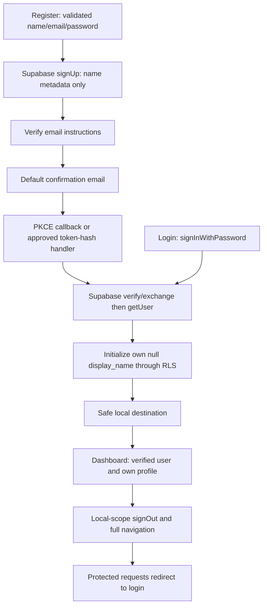

# Task 03B-2 — Authentication UI and integration review

Date: 13 October 2026. Branch: `feat/authentication`, HEAD `6bc4fbc`.

Local implementation is ready for review. Hosted end-to-end authentication is **NOT RUN**, pending explicit approval and suitable disposable inboxes. This is not a final hosted Authentication PASS.

## Changes and flow

Login, Register and Verify Email reuse the Task 03B-1 client-injected service, callback validation, SSR cookie adapters and route guards. Forms use Zod, accessible labels, field errors, focus on validation failure, password visibility, loading/disabled states and generic provider errors. Registration accepts no role or user ID. Duplicate signup success is deliberately neutral and does not expose the returned user. No email/password is placed in URLs or browser storage by application code.



The existing database trigger creates USER profiles. Validated display_name metadata is a non-authoritative name hint; after verified login/callback, only that column is updated, filtered by the verified user ID and an existing null name. It never overwrites an existing name or writes role. RLS and column grants remain authoritative. A failed profile update can leave the name unset; profile loading displays an explicit error/empty state. No migration changed.

Dashboard reads real `profiles.display_name, role` and verified Auth email. Its loading UI and logout errors are implemented. No authenticated dashboard screenshot is claimed without a real test session. Logout uses full navigation to clear the mounted authenticated UI/router state; browser Back and cross-tab behavior still require hosted verification.

## Session and security design

Clients remain per request on the server. Proxy and protected Server Components call verified `getUser`, never authorize from unverified `getSession`. Callback cookies, refreshed chunks and deletion options propagate through the existing response adapter. Login/Register/Verify and protected responses are dynamic and private/no-store. Existing SameSite/Secure options and SDK HttpOnly behavior remain unchanged: mixed browser SSR cookies are not globally HttpOnly.

Safe return-path validation is reused for UI links, login navigation and callbacks. Absolute, protocol-relative and encoded unsafe paths fall back to `/dashboard`. React escapes names; metadata is never a role source. Browser operations use only public publishable configuration and Supabase Auth/RLS. Passwords/tokens are not logged or manually persisted. No new server POST endpoint or custom password system was introduced.

Resend disables overlapping submissions and waits 60 seconds after each provider response, including errors. This is a UX throttle, not a security rate limiter across tabs/reloads. Supabase enforces actual limits. Abuse protection/SMTP/CAPTCHA and provider account-enumeration behavior require deployment review.

## Cloud inspection and proposed approval scope

Read-only Dashboard inspection of `campusfind-dev`:

| Setting | Observed |
| --- | --- |
| New signups | Enabled |
| Email provider | Enabled |
| Confirm email | Enabled |
| Anonymous sign-in | Disabled |
| Site URL | `http://localhost:3000` |
| Redirect allowlist | Empty; needs configuration before callback tests |
| Confirmation template | Default `.ConfirmationURL` link |
| Custom SMTP | Disabled |
| Email OTP/link expiry | 3600 seconds |

**Proposed change, not applied:** add `http://localhost:3000/**` to Redirect URLs for local development. Keep Site URL and Confirm email unchanged. This documented development-only wildcard permits encoded callback query values on the trusted local origin. The application still restricts callback return destinations; verify the actual email redirect after approval. Do not add preview port 3101 unless intentionally changing both trusted local origin and allowlist. Production URLs must be reviewed separately with tightly scoped destinations.

Default SMTP is restricted to organization-member recipients and approximately two emails/hour; a non-personal test inbox must meet these restrictions or an explicitly approved SMTP setup is needed. Current Dashboard blocks editing templates without SMTP. Therefore keep the default PKCE template for initial testing. The token-hash handler is locally tested but a real token-hash email flow is NOT RUN; do not claim both hosted callback modes passed. Default PKCE requires opening the email in the registration browser with its verifier cookie.

References: [Supabase SMTP restrictions](https://supabase.com/docs/guides/auth/auth-smtp), [Auth rate limits](https://supabase.com/docs/guides/auth/rate-limits), [redirect URLs](https://supabase.com/docs/guides/auth/redirect-urls), [SSR guide](https://supabase.com/docs/guides/auth/server-side/creating-a-client), [Next.js authentication](https://nextjs.org/docs/app/guides/authentication).

After approval: run the app at the trusted localhost:3000 origin, create approved disposable accounts through the public API/UI, confirm email, check Auth/profile USER creation, dashboard persistence, actual refresh/expiry and logout, bad credentials, expired links and cross-user profile SELECT/UPDATE denial. Use user-session public clients, never a privileged key to substitute for RLS tests. Do not delete accounts automatically. Inbox access/confirmation may require human participation. Never share passwords, tokens or live email links in reports.

## Fresh validation

| Check | Result |
| --- | --- |
| ESLint | PASS |
| TypeScript | PASS |
| Production build | PASS |
| Auth unit tests | PASS: 27; 24 foundation + 3 validation/name security tests, mocked providers |
| Configuration tests | PASS: 5 |
| Anonymous localhost HTTP | PASS: 13; protected routes, invalid callbacks, form rendering/cache/safe links |
| Browser desktop 1280px | PASS: register validation, focus, no horizontal overflow |
| Browser mobile 375px | PASS: login errors/toggle/safe links, register mismatch, no horizontal overflow |
| Verification UI | PASS: instructions and invalid-email validation; no resend HTTP sent |
| git diff --check | PASS |
| Production dependency audit | PASS: zero findings with --omit=dev |
| Full dependency audit | FAIL: five high findings in existing ESLint fast-glob/micromatch/braces chain |
| Hosted signup/email/login/logout/refresh/USER/RLS | NOT RUN: requires explicit account/config approval |
| Hosted settings/schema changes | NOT RUN: no changes applied |

Full npm audit recommends downgrading eslint-config-next to 14.x, incompatible with the current Next 16 toolchain. Do not blindly run audit fix --force. Resolve the development-only dependency chain in a separate compatibility-reviewed update; no production dependency vulnerability was reported. Existing configuration tests emit a non-failing Node module-type inference warning.

Screenshots: `/tmp/campusfind-auth-desktop.png` and `/tmp/campusfind-auth-mobile.png`. Browser checks used actual production UI without submitting valid credentials. These checks do not verify successful/loading provider behavior, authenticated dashboard visuals, email delivery, concurrent refresh or cross-user RLS.

## Local review and next steps

```sh
npm ci
npm run dev
# Trusted local origin: http://localhost:3000
npm run lint
npm run typecheck
npm run test:auth
npm run test:supabase-config
npm run build
# Anonymous preview checks can use another local port:
npm run start -- --port 3101 --hostname 127.0.0.1
npm run test:auth-routes -- http://127.0.0.1:3101
git diff --check
```

Task 03B-2 adds `src/components/ui/input.tsx`, auth form/page/logout/profile/validation helpers, Register/Verify pages, dashboard loading, this report and Zod dependency/lock updates. It extends the existing login/dashboard, auth service/callback/proxy, CSS feedback tokens, README and auth tests. All Task 03B-1 changes remain uncommitted and are included in the complete review patch.

`.env.local` and CLI caches remain ignored. Other checkout `/home/atuna/campusfind-serverless` retains its original next.config.ts edit. No commit, push, PR, merge, database migration, paid resource or Cloud mutation was performed.

Complete combined diff: `/tmp/campusfind-task03b2-review.diff`. Review the UI first, then explicitly approve the limited redirect configuration and test-account scope. Finish hosted Authentication integration before starting the Reporting module. Git publishing requires separate explicit approval.

## Approved hosted test continuation — 13 October 2026

After explicit approval, `http://localhost:3000/**` was saved in the development redirect allowlist; Site URL stayed localhost:3000 and email confirmation stayed enabled. The user supplied the team-member email and entered the password directly in the local form. The approved UI signup completed and navigated to verification instructions. Supabase Auth Dashboard independently showed the created account with display name Anh Tuấn. No password, token or callback credential was read or recorded by the agent.

Hosted signup: PASS (real browser form and Cloud user record). Email delivery/confirmation, login, profile USER, persistence/refresh, logout and cross-user RLS: pending, not PASS. Await the human's inbox confirmation in the registration browser. No migration, Git publishing or account deletion occurred. Evidence: `/tmp/campusfind-redirect-saved.png` and `/tmp/campusfind-signup-verification.png`.

## Verified authenticated Dashboard continuation — 13 October 2026

After the human's email-confirmation action, the actual browser reached `/dashboard`. It displayed the real profile name Anh Tuấn, Auth email and database role USER. Reloading the page retained the authenticated Dashboard and its profile. Evidence: `/tmp/campusfind-dashboard-verified.png`. This confirms the confirmation-to-Dashboard flow and session persistence across reload; it is not a separate password-login or forced-expiry refresh test.

The anonymous HTTP smoke script was adjusted to resolve relative Location headers against the request base because Next.js dev uses relative redirects. Its existing destination-origin checks remain in place. Hosted password-login, forced expiry/refresh, logout and cross-user profile restrictions still require further verification. The human's authenticated browser session was preserved.
