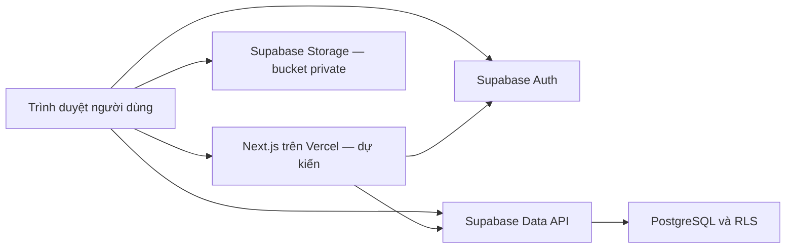

# BÁO CÁO TIẾN ĐỘ TRIỂN KHAI CLOUD CAMPUSFIND

**Giai đoạn:** Task 06A — Initial Vercel Cloud Deployment
**Ngày lập báo cáo:** 01/11/2026
**Repository:** `aanhtuan/campusfind-serverless`
**Nhánh chuẩn bị triển khai:** `chore/vercel-initial-deployment`
**Commit được kiểm tra:** `9b0790953cc54a56ff41d636f3294cd6a7593bf9`

## 1. Kết quả hiện tại

CampusFind đã hoàn thành kiểm tra mã nguồn và các điều kiện kỹ thuật ban đầu để chuẩn bị triển khai lên Vercel. Các kiểm thử thiết yếu, lint, typecheck, production build và kiểm tra bảo mật dependency production đều đạt.

Đã đăng nhập và kiểm tra cấu hình thực tế trên Vercel và Supabase theo chế độ chỉ đọc. Supabase đang hoạt động bình thường. Trong phạm vi Vercel Atunas chưa có project CampusFind và chưa liên kết GitHub.

**Vercel deployment: NOT RUN.** Chưa có website HTTPS, domain production, deployment ID hoặc kết quả kiểm thử ứng dụng trên Vercel. Việc tạo project và các thay đổi Cloud vẫn chờ phê duyệt cụ thể. Yêu cầu lập báo cáo không được coi là phê duyệt triển khai.

## 2. Mục tiêu và phạm vi hệ thống

CampusFind là hệ thống quản lý đồ thất lạc trong khuôn viên trường đại học. MVP hiện có các chức năng xác thực, đăng báo cáo LOST/FOUND, quản lý báo cáo của người dùng và tìm kiếm đồ thất lạc.

| Thành phần | Tình trạng |
| --- | --- |
| Authentication | Đã tích hợp đăng ký, đăng nhập, đăng xuất, xác minh email và bảo vệ route |
| Item Reporting | Đã tích hợp tạo/sửa báo cáo và quản lý ảnh riêng tư |
| Search & Discovery | Đã tích hợp danh sách, tìm kiếm, lọc và xem chi tiết |
| Next.js security patch | Đã tích hợp phiên bản 16.4.3 |
| Bảo vệ form Authentication | Đã tích hợp bản sửa nguy cơ gửi thông tin đăng nhập qua GET trước hydration |
| Vercel frontend hosting | Chưa triển khai |
| Ownership Claims và Edge Functions | Chưa triển khai trong phạm vi hiện tại |

Các thay đổi đã được tích hợp vào baseline gồm PR #6 (Next.js security), PR #7 (Reporting), PR #8 (Search) và PR #9 (Authentication form security). Không nhập toàn bộ worktree kiểm thử Authentication cũ vào nhánh triển khai.

## 3. Kiến trúc triển khai dự kiến

Supabase Cloud hiện cung cấp Auth, PostgreSQL và Storage. Vercel sẽ phục vụ ứng dụng Next.js sau khi được phê duyệt. Edge Functions cho quy trình Claims thuộc giai đoạn tiếp theo, chưa có bằng chứng thực thi để đưa vào báo cáo triển khai này.

## 4. Kết quả kiểm tra mã nguồn

Kết quả dưới đây được lấy từ lần preflight đã chạy trên commit nêu trên. Không chạy lại toàn bộ kiểm thử trong lượt lập báo cáo vì không có thay đổi mã nguồn hoặc cấu hình ứng dụng.

| Kiểm tra | Kết quả |
| --- | --- |
| `npm ci` | PASS |
| `npm run lint` | PASS |
| `npm run build` | PASS — Next.js 16.4.3, webpack |
| `npm run typecheck` | PASS sau build |
| `npm run test:auth` | PASS — 32/32 |
| `npm run test:reports` | PASS — 22/22 |
| `npm run test:search` | PASS — 31/31 |
| `npm run test:supabase-config` | PASS — 5/5 |
| `npm audit --omit=dev` | PASS — 0 findings |
| Kiểm tra whitespace của diff tài liệu | PASS |
| GitHub Actions trên nhánh triển khai | NOT RUN — chưa publish nhánh |

Tổng cộng **90 kiểm thử tự động PASS** trong bốn nhóm Auth, Reporting, Search và cấu hình Supabase. Production audit không bao gồm dependency chỉ phục vụ phát triển. Báo cáo này không suy diễn kết quả full dependency audit từ production audit.

Build preflight chưa sử dụng bộ biến môi trường của Vercel. Build thành công chứng minh khả năng biên dịch của baseline; chưa chứng minh kết nối runtime, redirect email hoặc hoạt động người dùng trên Cloud.

## 5. Kết quả kiểm tra Vercel

| Nội dung | Kết quả quan sát |
| --- | --- |
| Tài khoản đăng nhập | `nguyenanhtuan13022005-5305` |
| Team/scope | Atunas (`atunas`) |
| Gói hiện tại | Hobby |
| Project trong scope được kiểm tra | 0 — dashboard hiển thị “Deploy your first project” |
| Kết nối GitHub | Chưa liên kết; dashboard hiển thị “Connect your GitHub account” |
| Project CampusFind | Chưa tạo |
| Domain và deployment ID | Chưa có |
| Thay đổi đã thực hiện | Không có |

Kết luận này chỉ áp dụng cho tài khoản/scope đã kiểm tra. Chưa cấp quyền repository, kết nối GitHub, mua dịch vụ hoặc thực hiện Deploy.

Theo [tài liệu Vercel về lần triển khai đầu tiên](https://vercel.com/docs/deployments/environments#first-deployment), lần deployment đầu tiên của project mới nhắm tới Production. Không được coi thao tác import repository hoặc lựa chọn Preview là bằng chứng rằng lần deploy đầu sẽ an toàn ở môi trường Preview.

## 6. Kết quả kiểm tra Supabase Cloud

| Nội dung | Giá trị/trạng thái đã xác minh |
| --- | --- |
| Project | `campusfind-dev` |
| Project reference | `gxbpprhivyxmtcqibncf` |
| Trạng thái | ACTIVE_HEALTHY |
| Khu vực | Sydney — `ap-southeast-2` |
| Gói | Free |
| PostgreSQL | 17.11.0.003 |
| Site URL | `http://localhost:3000` |
| Redirect URL hiện có | `http://localhost:3000/**` |
| Email confirmation | Bật |
| Email authentication | Bật |
| Anonymous sign-in | Tắt |
| Link trong template xác minh | `{{ .ConfirmationURL }}` |

Template mặc định tương thích với luồng callback PKCE hiện có. Route `/auth/confirm` hỗ trợ token-hash vẫn được giữ nguyên. Chưa sửa template, cấu hình SMTP, provider, JWT expiry hoặc session; không gửi email trong giai đoạn kiểm tra này.

Kiểm tra metadata chỉ đọc xác nhận RLS được bật cho `profiles`, `items`, `item_images` và `claims`. Bucket `item-images` vẫn **private**, giới hạn **5 MiB**, chấp nhận JPEG, PNG và WebP. Không thay đổi migration hoặc policy.

Số báo cáo OPEN/IN_PROGRESS tại thời điểm kiểm tra là **0**. Truy vấn metadata bằng connector quản trị xác nhận cấu hình và kết nối; không thay thế kiểm thử Data API bằng quyền người dùng hoặc kiểm thử RLS thực tế.

Security advisor có cảnh báo sẵn có về Leaked Password Protection chưa bật. Theo [tài liệu Supabase](https://supabase.com/docs/guides/auth/password-security#password-strength-and-leaked-password-protection), tính năng này yêu cầu Pro trở lên. Không nâng gói hoặc thay đổi cấu hình trong nhiệm vụ hiện tại.

## 7. Cấu hình triển khai đề xuất

| Thiết lập | Đề xuất — chưa áp dụng |
| --- | --- |
| Project | `campusfind` trong Atunas/Hobby |
| Repository | `aanhtuan/campusfind-serverless` |
| Production branch | `main` |
| Commit được duyệt kỹ thuật | `9b0790953cc54a56ff41d636f3294cd6a7593bf9` |
| Framework | Next.js |
| Node.js | 22.x |
| Root directory | Gốc repository |
| Install | `npm ci` |
| Build | `npm run build` — giữ webpack |
| Output | Theo tích hợp Next.js mặc định |
| Chi phí | Chỉ dùng phạm vi miễn phí; không mua domain, add-on hoặc nâng gói |

Ba tên biến môi trường cần cấu hình sau khi được phê duyệt:

- `NEXT_PUBLIC_SUPABASE_URL`
- `NEXT_PUBLIC_SUPABASE_PUBLISHABLE_KEY`
- `NEXT_PUBLIC_SITE_URL`

Không đưa giá trị key đầy đủ vào báo cáo. Không sử dụng service-role key cho frontend. `NEXT_PUBLIC_SITE_URL` phải lấy từ HTTPS origin thực tế, đáng tin cậy của project; chưa được đoán domain từ tên `campusfind`.

Sau khi xác minh domain, cần trình phê duyệt riêng thay đổi Site URL và redirect callback production của Supabase, đồng thời giữ redirect localhost phục vụ phát triển. Không đề xuất wildcard toàn bộ preview domain hoặc vô hiệu hóa email confirmation.

## 8. Ma trận nghiệm thu và giới hạn

| Hạng mục | Trạng thái và phạm vi bằng chứng |
| --- | --- |
| Baseline tích hợp và các kiểm tra local thiết yếu | PASS |
| Supabase health và cấu hình metadata | PASS — kiểm tra chỉ đọc |
| Xác minh Vercel account/team/plan | PASS |
| Đọc cấu hình Auth URL và template thực tế | PASS |
| Authentication/RLS hosted của giai đoạn trước | Theo kết quả đã được ghi nhận trước đó; không chạy lại trong Task 06A |
| Tạo project và cấu hình Vercel | NOT RUN — chờ phê duyệt |
| Deployment Vercel và website HTTPS công khai | NOT RUN |
| Public-route HTTP smoke trên Vercel | NOT RUN |
| Login/session/logout trên website Vercel | NOT RUN |
| Hosted Reporting/Storage E2E | NOT RUN |
| Positive hosted Search/private-photo E2E | NOT RUN |
| Thuộc tính cookie HTTPS và cache isolation trên deployment | NOT RUN |
| UI mobile trên deployment hoặc thiết bị thật | NOT RUN |
| Natural session expiration và các email edge case chưa chạy | NOT RUN; không mở rộng Authentication trong nhiệm vụ này |
| Xác nhận người dùng đã đổi mật khẩu sau sự cố trước đây | UNCONFIRMED |

Bản sửa form chống GET fallback đã có trong main. Tuy nhiên, tình trạng đổi mật khẩu sau lần lộ thông tin cục bộ trước đây chưa được người dùng xác nhận. Không đọc, ghi lại, yêu cầu cung cấp hoặc tự đổi mật khẩu.

Cần kiểm tra thuộc tính cookie thực tế trên HTTPS trước khi nghiệm thu production. Chưa kết luận toàn bộ cookie có Secure/HttpOnly chỉ từ source review. SDK phía trình duyệt hiện sử dụng cookie có thể đọc bằng JavaScript và SameSite=Lax.

Các giới hạn về ảnh private và khả năng còn object mồ côi khi thao tác Storage/database không hoàn tất phải tiếp tục được theo dõi; báo cáo này không xác nhận đã nghiệm thu hosted photo flow. Không tạo tài khoản, báo cáo hoặc ảnh thử khi chưa có phê duyệt riêng.

## 9. Trình tự tiếp theo và cổng phê duyệt

1. Xin phê duyệt tạo duy nhất project rỗng `campusfind` trong Atunas/Hobby để xác định domain và cấu hình thực tế. Nếu luồng tạo project khởi chạy deployment, dừng trước thao tác cuối để xin duyệt riêng.
2. Đọc project ID và domain thực tế; nếu cần gán domain miễn phí riêng, trình domain cụ thể trước khi thêm.
3. Trình phê duyệt chính xác quyền kết nối GitHub, cấu hình build, phạm vi biến môi trường và thay đổi Auth URL.
4. Xin duyệt lần triển khai ứng dụng đầu tiên với nhận thức rõ đây là Production-target deployment. Xem xét staging không tự gán production domain nếu điều khiển thực tế hỗ trợ.
5. Sau deployment được duyệt, ghi nhận URL/ID thật và kiểm tra HTTPS/public routes không tạo dữ liệu.
6. Kiểm thử hosted chức năng có đăng nhập hoặc có ghi dữ liệu theo phạm vi được phê duyệt riêng. Public promotion, nếu tách khỏi deployment đầu, cần phê duyệt riêng.

Hiện **chưa có phê duyệt cho bước 1**. Không tự commit, push, merge, deploy hoặc thay đổi Supabase Cloud.

## 10. Bằng chứng và bàn giao

Các bằng chứng preflight và kiểm tra dashboard được lưu cục bộ tại `/tmp/campusfind-task06a-review/`:

| Bằng chứng | Nội dung |
| --- | --- |
| `baseline.json` | Commit, nhánh và các PR đã tích hợp |
| `results.json` và các file log kiểm tra | Kết quả local đã thực thi |
| `dashboard-inspection.json` | Kết quả đọc cấu hình Vercel/Supabase |
| `screenshots/vercel-atunas-before-create.jpg` | Dashboard Atunas/Hobby trước khi tạo project |
| `screenshots/supabase-auth-before-change.jpg` | Auth URL Configuration trước khi thay đổi |
| `stage-files.txt` | Danh sách tài liệu đề xuất bàn giao |
| `deployment-preflight.diff` | Diff tài liệu để review |

Ảnh trên chỉ là bằng chứng kiểm tra cấu hình dashboard, **không phải ảnh website đã triển khai**. Thư mục `/tmp` là bằng chứng cục bộ tạm thời, chưa được publish và cần lưu giữ riêng khi bàn giao lâu dài. Không đưa environment file, mật khẩu, JWT, log chứa thông tin đăng nhập hoặc screenshot không cần thiết vào Git.

Tài liệu kỹ thuật kèm theo trong repository:

- `docs/vercel-deployment.md`: hướng dẫn cấu hình và các cổng phê duyệt.
- `docs/task06a-deployment-report.md`: báo cáo checkpoint kỹ thuật bằng tiếng Anh.

Các worktree và chỉnh sửa của người dùng được giữ nguyên. Thay đổi hiện tại chỉ là tài liệu chuẩn bị triển khai. **Đánh giá Task 06A: preflight PASS; triển khai và nghiệm thu Cloud chưa hoàn tất, chờ phê duyệt.**
