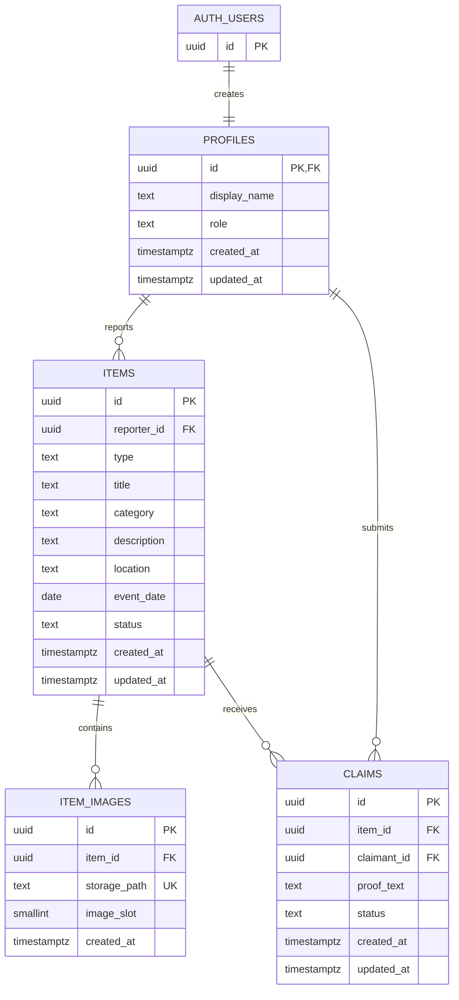

# CampusFind database design — Task 02B

This task defines the database contract for Accounts & Access, Item Reporting & Discovery, and Claims & Resolution. It adds no frontend features, Auth UI, Edge Functions, hosted project, or deployment. Four application tables live in `public`; internal trigger functions live in `campusfind_private`, outside the configured Data API schemas.

## Entity relationships

`auth.users` is managed by Supabase. Storage objects are related by bucket/path, not by an application FK; database and object uploads are separate operations.

## Tables and fields

All IDs use UUIDs. Application-created rows receive `gen_random_uuid()` IDs; profile IDs must equal the Auth user ID. All timestamps are non-null `timestamptz`, defaulting to `now()`. Update triggers replace `updated_at`; clients cannot supply IDs or timestamps when creating reports/images.

### profiles

| Field | Definition / purpose |
| --- | --- |
| `id` | PK and FK to `auth.users.id`, `ON DELETE CASCADE` |
| `display_name` | Nullable; trimmed length 1–100 when supplied |
| `role` | Required `USER` or `ADMIN`; default `USER` |
| `created_at`, `updated_at` | Creation and latest update timestamps |

An Auth insert creates a profile with role `USER`. User-controlled Auth metadata is not copied. Existing Auth users are backfilled as `USER`. Auth signup failure rolls back if the profile trigger fails. Users may update only their own display name. ADMIN provisioning is a future trusted administrative task; ADMIN is not an RLS bypass or permission to read all claims. No public profile endpoint/view exists in this task.

### items

| Field | Definition / purpose |
| --- | --- |
| `id` | UUID PK, generated by default |
| `reporter_id` | Required profile FK, defaults to `auth.uid()`, `ON DELETE RESTRICT` |
| `type` | Required `LOST` or `FOUND`; immutable after creation |
| `title` | Required, trimmed length 1–200 |
| `category` | Required, trimmed length 1–80; vocabulary deferred |
| `description` | Nullable, at most 5,000 characters |
| `location` | Required, trimmed length 1–200; location vocabulary deferred |
| `event_date` | Required `date`; no past-only restriction |
| `status` | Required `OPEN`, `IN_PROGRESS`, `RESOLVED`, `CLOSED`; default `OPEN` |
| `created_at`, `updated_at` | Creation and latest update timestamps |

Clients can create their own reports and edit only title/category/description/location/event_date. Identity, reporter, type, creation timestamp and status are protected. Type is fixed to prevent changing a FOUND report with claims into LOST. Guests and other members see only OPEN/IN_PROGRESS reports; reporters also see their own terminal reports. There is no client or service-role hard-delete grant on items.

### item_images

| Field | Definition / purpose |
| --- | --- |
| `id` | UUID PK, generated by default |
| `item_id` | Required item FK, `ON DELETE RESTRICT` |
| `storage_path` | Required globally unique lowercase UUID path in `item-images` |
| `image_slot` | Internal required slot 1–3, unique together with `item_id` |
| `created_at` | Creation timestamp |

A BEFORE INSERT trigger locks the parent item and assigns the lowest free slot. Clients cannot choose slots or reassign metadata. The slot CHECK and `(item_id, image_slot)` unique constraint guarantee at most three records, even when snapshots are stale. Concurrent requests may receive CHECK/unique/serialization errors; retry a complete failed transaction only when appropriate. Reporters can insert/delete records; replacement uses delete followed by insert, not UPDATE. Restrictive FKs preserve references if a privileged operator attempts item deletion.

### claims

| Field | Definition / purpose |
| --- | --- |
| `id` | UUID PK, generated by default |
| `item_id` | Required item FK, `ON DELETE RESTRICT` |
| `claimant_id` | Required profile FK, `ON DELETE RESTRICT` |
| `proof_text` | Required private ownership evidence, trimmed length 1–5,000 |
| `status` | Required `PENDING`, `APPROVED`, `REJECTED`, `CANCELLED`; default `PENDING` |
| `created_at`, `updated_at` | Creation and latest update timestamps |

No anon access and no direct authenticated writes. A trigger locks the item and requires FOUND, a different claimant/reporter, an active item, and PENDING initial status. Evidence and identity are immutable. Only the claimant and reporter can read a claim, including after item resolution. An approved claim remains active for uniqueness; rejected/cancelled users may submit a new claim in a later workflow. Other pending claimants are not automatically rejected upon approval in Task 02B.

## Status transitions and future transactions

| Entity | Permitted transition | Future authorized actor |
| --- | --- | --- |
| Item | OPEN → IN_PROGRESS, RESOLVED, CLOSED | Reporter through trusted workflow |
| Item | IN_PROGRESS → RESOLVED, CLOSED | Reporter through trusted workflow |
| Item | RESOLVED → CLOSED | Reporter through trusted workflow |
| Claim | PENDING → APPROVED, REJECTED | Item reporter through trusted workflow |
| Claim | PENDING → CANCELLED | Claimant through trusted workflow |

CLOSED and all non-PENDING claim statuses are terminal. No reopening is implemented. LOST reports may be resolved without a claim. Claim approval means ownership has been accepted; it does not prove handover. The later workflow must mark a confirmed handover RESOLVED, distinct from APPROVED.

These are database transition guards, not actor-authenticated write endpoints. The service role bypasses RLS: the later Edge Function must authenticate the caller and verify the actor using trusted data. Auth user/actor IDs cannot come from unchecked request fields. Multi-statement approval/item-status updates require one database transaction, typically a narrowly granted RPC added in the workflow task. Separate Supabase HTTP calls from an Edge Function are not atomic. Lock the item before related claim rows, recheck state after locking, and handle unique/serialization/deadlock errors. Do not expose a generic service-role SQL proxy.

## Indexes and integrity

| Index / constraint | Purpose |
| --- | --- |
| PKs and FKs | Referential integrity; profiles link to Auth |
| `items_reporter_idx` | Owner history and RLS ownership lookups |
| `items_discovery_idx` | Status/type/category/event-date filtering |
| `items_location_idx` | Exact location/date filtering |
| `items_search_idx` | GIN full-text search over title, description, location using `simple` dictionary |
| Unique `storage_path` | No duplicate metadata path |
| Unique `(item_id, image_slot)` + slot CHECK | Atomic three-image maximum and item lookup |
| `claims_claimant_idx`, `claims_item_idx` | Private claimant/reporter history and FK lookups |
| `claims_one_approved_per_item` | Partial unique item index for APPROVED claims |
| `claims_one_active_per_claimant` | Partial unique `(item_id, claimant_id)` for PENDING/APPROVED |

The search index does not implement a search API. Categories and locations remain free text until product requirements are agreed. No extra category/location tables or extensions are needed for these indexes.

Auth deletion cascades to unused profiles, but reports/claims RESTRICT deletion of referenced profiles. A referenced account therefore cannot simply be removed from Auth; retention, anonymization and account closure require a separate reviewed workflow. No automatic cascade destroys item/claim history. There is no campus-membership schema or isolation yet: this MVP database assumes a single campus and treats any authenticated user as a member. Verify university membership in the next access-design task before exposing member features.

## Storage design

- Private bucket: `item-images`.
- Maximum upload size: 5 MiB; accepted MIME types: JPEG, PNG, WebP.
- Path: `<reporter_uuid>/<item_uuid>/<file_uuid>.<jpg|jpeg|png|webp>`.
- Upload must match the signed-in reporter's ID, actual item ownership, and Storage `owner_id`.
- Reporters can preview unregistered uploads, register/delete metadata, and delete their objects.
- Other authenticated users can read only registered images on reports visible through item RLS.
- Guests see report text only; no guest image access or signed URL endpoint is implemented.
- No UPDATE policy: overwrites/upsert/moves are unavailable through the client.

A public bucket would allow anyone with a URL to retrieve a photo without Storage read policies. Switching it to public would break the chosen privacy boundary. Photos may expose names, addresses or location data; require a product policy for redaction and EXIF handling. Private signed URLs, if added later, remain bearer links until expiry and must have a short lifetime.

The three-slot limit covers **registered metadata**, not arbitrary uploaded objects. An upload can become an orphan if metadata registration fails; a metadata record can refer to a missing object. Future upload orchestration must implement compensation/cleanup and quotas. Never DELETE real file metadata directly in SQL; use the Storage API. No byte-level content validation, thumbnailing, malicious-image scanning or physical-object existence trigger exists here.

## Migrations and local setup

1. `20261012000100_application_schema.sql`: four tables, constraints, indexes, internal functions, Auth/profile automation, grants and RLS.
2. `20261012000200_private_image_storage.sql`: private bucket metadata and scoped Storage policies.

Each migration is transactional and runs once through migration history. It intentionally fails on conflicting application tables/bucket IDs rather than silently replacing existing objects. Apply only to a reviewed development database; no remote is linked by this task. `config.toml` identifies the separate local project `campusfind-task02b`, exposes only `public`, disables implicit exposure, and uses PostgreSQL 17. The internal schema must stay outside the Data API.

For exact commands, test results and limitations see [RLS and security validation](rls-security.md).
