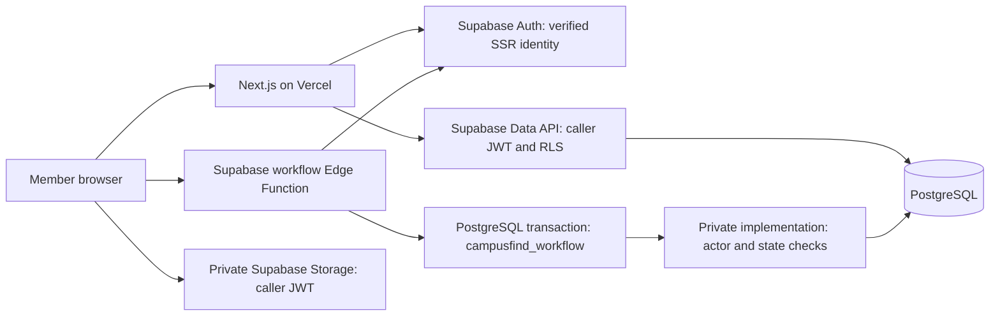

# Claims and return workflow

## Architecture

Next.js renders public text from explicit field allowlists and protected participant pages from request-scoped SSR clients. Browser mutations send a verified user JWT to the `workflow` Edge Function. The function validates input, verifies the user with Auth, then invokes one allowlisted database operation using the same caller context. It never creates a service-role client. The public SECURITY INVOKER wrapper calls a private-schema SECURITY DEFINER implementation because ordinary clients deliberately lack table mutation/status privileges. That implementation checks `auth.uid()`, ownership and current state before each write; it has no SQL text/actor-ID input. Private schema is outside the Data API. Only narrow predicates and workflow/overview implementations are executable by authenticated users; original trigger routines stay non-executable. All definers pin an empty search path.

## Item and claim state

- FOUND: `OPEN` → claim approval → `IN_PROGRESS` → two return confirmations → `RESOLVED` → reporter closure → `CLOSED`.
- LOST: `OPEN` → finder response → reporter selection and private owner evidence (still `OPEN`) → holder verifies → `IN_PROGRESS` → two return confirmations → `RESOLVED` → closure. Independent recovery is allowed only without a selected/approved response.
- Claim: `PENDING` → `APPROVED`, `REJECTED` or claimant `CANCELLED`. Submitted evidence stays immutable. For an unverified selected LOST response only, mismatch or withdrawal can move `APPROVED` → `REJECTED` while the item remains `OPEN`. Verified/terminal outcomes cannot be reversed.
- Only OPEN FOUND reports accept new ownership claims; OPEN LOST reports accept finder responses (including queued responses while verification is pending). Existing IN_PROGRESS reports remain discoverable while coordination proceeds, with no new claim button.
- Public discovery explicitly excludes RESOLVED/CLOSED even for signed-in owners. Own reports and a claimant's related item history remain visible under RLS, including registered private photos. Unrelated users retain no terminal access.

Approval locks item first, then claim, checks ownership and OPEN/PENDING, approves one claim, rejects other pending claims and advances the item in **one transaction**. The original partial unique indexes remain; the new additive migration extends guards for LOST responses without altering existing migration files. For LOST selection the item stays OPEN; holder verification atomically persists verification, rejects any later queued responses and moves to IN_PROGRESS. The reporter is the recipient for LOST and the holder for FOUND; confirmation columns retain record identities, not custody roles. A stable random `request_id` makes submission replay safe after an ambiguous network outcome; no client automatically retries mutations. Other actions report an unconfirmed outcome and require a refresh before retrying.

## Minimal schema additions

| Table | Purpose and visibility |
| --- | --- |
| `handovers` | One row per approved claim: campus point, UTC meeting time, proposer, revision, change request, acceptance, two separate confirmations. Participants only. |
| `claim_contacts` | One explicit opt-in value per participant/claim, type and consent time. No account email copied. Presence means consent; revocation deletes only caller's row. Approved participants only. |
| `workflow_issues` | Structured category, status, opening actor, two resumption timestamps. Participants and ADMIN can read these limited operational records. No free-text evidence or contact. |

No existing migration or claim status is rewritten. Versioned additions: `20261105065313_claims_handover_workflow.sql` and `20261109154529_lost_finder_response.sql`. The latter adds nullable owner proof/submission/verification columns to claims and a guarded workflow entry point. The renamed base implementation is no longer executable by members; public/private callable entries cannot bypass LOST verification. New tables have RLS and SELECT grants only to authenticated users. Table mutation privileges remain denied; workflow RPCs provide checked mutations. ADMIN receives no evidence/contact/handover policy.

## Operation contract

All calls: `POST /functions/v1/workflow`, JSON `{ "action": "...", "data": {...} }`, user bearer token. Extra actor/role/status fields are rejected. Database independently validates permitted fields, evidence, meeting point/time, contact consent and state. CORS permits bearer-authenticated browser requests without cookies. Responses use private/no-store and sanitized messages.

| Action | Data | Authorization / effect |
| --- | --- | --- |
| `submit_claim` | item_id, proof_text, request_id | Another member's OPEN FOUND, 20–5000 trimmed characters, unique active claimant |
| `submit_found_response` | item_id, proof_text, request_id | Another member's OPEN LOST, private 20–5000 character description of held item, idempotent request UUID |
| `submit_owner_proof` | claim_id, proof_text | LOST reporter, selected response, immutable private 20–5000 character ownership evidence |
| `verify_owner` | claim_id, decision | Selected LOST holder only; APPROVED verifies and starts coordination, REJECTED leaves item OPEN |
| `withdraw_match` | claim_id | Either participant may end an unverified selected LOST match; no reversal after verification |
| `cancel_claim` | claim_id | Claimant, PENDING only |
| `review_claim` | claim_id, decision | Actual reporter; APPROVED/REJECTED only; LOST approval selects pending verification |
| `propose_handover` | claim_id, location, meeting_at, revision | Approved participant, IN_PROGRESS, revision matches; future within 90 days |
| `accept_handover` | claim_id, revision | Other participant; current future proposal; no pending change request |
| `request_change` | claim_id, revision | Participant; neither return confirmation recorded; requires a new proposal before acceptance |
| `confirm_return` | claim_id, revision | Participant confirms **own side only**, accepted arrangement, no unresolved issue |
| `share_contact` | claim_id, kind, value, consent | Approved participant; EMAIL/PHONE, valid value, consent must be boolean true |
| `revoke_contact` | claim_id | Approved participant deletes only own shared contact |
| `open_issue` | claim_id, category | IN_PROGRESS approved participant; MISSED_MEETING/RETURN_DISPUTED/SAFETY_CONCERN |
| `resume_issue` | claim_id, issue_id | Each participant independently agrees; both required to resolve issue |
| `acknowledge_issue` | issue_id | ADMIN from database profile only; acknowledges category without evidence access |
| `resolve_lost` | item_id | Reporter of OPEN LOST report with no selected response; rejects pending responses |
| `close_report` | item_id | Reporter of RESOLVED report |

Handover points are Campus security office, Student affairs office or University reception; verify these exist at the deploying campus. Form input uses the device's local time and serializes to an explicit UTC timestamp; agreed details display Vietnam time with a timezone label. Every proposal/change has a new revision; stale acceptance/confirmation fails. Requesting a change clears agreement, preserving proposal until replacement. Accepted details cannot be replaced without a change request. After either confirmation, arrangement changes are blocked. An issue pauses confirmations; both parties can resume without altering the approved claim or deleting either confirmation. This is a recovery path, not a dispute adjudication service. If one party refuses to resume, the item remains IN_PROGRESS for human campus assistance; Admin cannot force a return outcome.

## UI and privacy

`/claims/new?item=...` previews evidence before submission; `/my-claims` and `/incoming-claims` paginate private requests; `/claims/[id]` holds evidence, review, handover and history. Report management exposes independent LOST recovery, incoming claims and completed closure. Shared member navigation links all functional pages and logout; database ADMIN adds `/admin`. Admin rechecks its database role and RPC independently enforces the same rule.

Sensitive forms use POST and disabled controls until hydration; evidence/contact fields are never placed in URLs. ProtectedSession masks stale protected UI on signout, focus/back restoration and identity changes. Do not place ownership evidence in public report photos or descriptions. Account email remains visible only on one's own dashboard. Roles cannot be assigned through registration metadata or profile column writes.

## Storage reconciliation

Existing upload compensation preserves a metadata registration when only its response was lost. Photo manager adds owner-scoped discovery of up to 100 oldest objects for the current report that are at least 24 hours old and lack metadata. Users reconcile exact candidate paths; each operation rechecks registration before deletion. Registered images, recent uploads and other users' reports are skipped. This recovers uploads from a lost tab without a privileged scheduled sweeper. It is bounded and best-effort: cross-service Storage/database writes are not one transaction; simultaneous manual registrations can still race a cleanup check, so do not run recovery while uploading the same report in another tab. Missing objects are shown as failed photo loads and can be removed/reuploaded by the reporter. Quotas, scheduled reconciliation, EXIF redaction and content scanning remain follow-ups.

## Deliberate limits

No chat, external search service, paid resources, AI matching or realtime subscriptions. Title search retains safe scalar ILIKE filtering; description search is deferred to avoid changing existing query behavior. Single-campus membership remains the existing authenticated-user assumption; verified university membership needs an explicit product policy. ADMIN provision is an operator-only reviewed database task, never a registration field or client UI.
