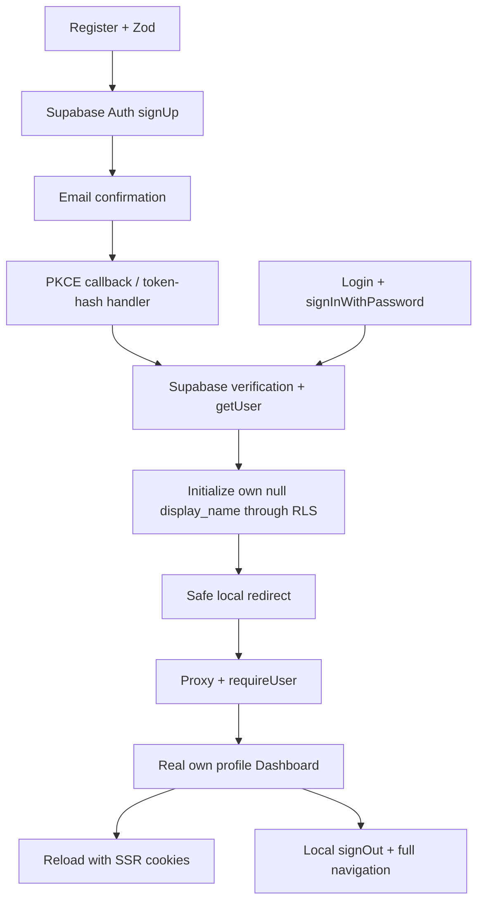

# BÁO CÁO TỔNG HỢP TASK 03B — AUTHENTICATION

**Dự án:** CampusFind — Serverless Lost and Found Management System.

**Repository:** aanhtuan/campusfind-serverless.

**Nhánh triển khai:** feat/authentication.

**Nền tảng Git:** 6bc4fbc, sau khi Task 03A được tích hợp vào main.

**Ngày báo cáo:** 13/10/2026, giờ Việt Nam.

## 1. Kết luận nghiệm thu

**Triển khai local: PASS. Tích hợp Cloud: đã kiểm chứng một phần. Nghiệm thu toàn bộ vòng đời Authentication: PENDING.**

Task 03B gồm hai phần: 03B-1 xây nền tảng xác thực và quản lý phiên; 03B-2 bổ sung giao diện, nối Supabase và kiểm tra tích hợp. Đã có luồng đăng ký thật, xác nhận email có người dùng tham gia, Dashboard đọc dữ liệu thật và giữ phiên sau tải lại trang. Chưa kiểm chứng đầy đủ đăng nhập bằng mật khẩu, đăng xuất, refresh khi token hết hạn và RLS giữa hai tài khoản trên Cloud.

Báo cáo dựa trên bằng chứng trong quá trình thực hiện, đối chiếu trạng thái Git và báo cáo trước đó. Không chạy lại toàn bộ lint/build/hosted tests trong lần viết báo cáo tổng hợp này. Không coi unit test sử dụng mock là bằng chứng Cloud HTTP.

## 2. Phạm vi và nền tảng

- Next.js 16 App Router, TypeScript strict, Tailwind và Button theo hệ thống shadcn/ui hiện có.
- Supabase Auth/PostgreSQL với RLS; @supabase/ssr cho browser/server và cookies.
- Sử dụng NEXT_PUBLIC_SUPABASE_URL, NEXT_PUBLIC_SUPABASE_PUBLISHABLE_KEY và NEXT_PUBLIC_SITE_URL.
- Giữ nguyên migrations, trigger tạo profile và chính sách từ Task 02B.
- Không triển khai Reporting, Search, Claims business logic, Edge Functions hoặc Vercel.

Triển khai tiếp tục trên feat/authentication. Nhánh feature/auth cũ không bị ghi đè. Chỉnh sửa next.config.ts của người dùng trong checkout main được giữ nguyên. Không đồng bộ develop; trạng thái develop chậm main được ghi nhận ở bước chuẩn bị trước đó, chưa fetch lại trong lần viết báo cáo này.

## 3. Task 03B-1 — Authentication Foundation

### 3.1 Supabase clients và phiên server

Browser client sử dụng public publishable key và cơ chế lưu phiên/PKCE của @supabase/ssr. Server client được tạo mới cho mỗi request hoặc render, đọc cookies bằng API bất đồng bộ của Next.js. Không chia sẻ server client hoặc dữ liệu user toàn cục giữa các request.

Server Component dùng adapter đọc cookie; việc ghi refresh cookie do proxy và callback xử lý qua response-aware adapter. Adapter cập nhật request cookies để component phía sau thấy giá trị mới, đồng thời giữ các cookie chunks, cookie deletion và options để áp dụng lên response cuối cùng, kể cả redirect.

### 3.2 Proxy và bảo vệ route

Tích hợp src/proxy.ts theo Next.js 16. Identity được xác minh bằng Supabase getUser(), không lấy getSession() chưa xác minh làm căn cứ cấp quyền. Server Component của protected routes kiểm tra độc lập bằng requireUser().

| Route | Hành vi |
| --- | --- |
| /dashboard | Cần user đã xác minh; tải own profile |
| /items/new | Cần đăng nhập; hiện là shell, chưa có Reporting |
| /my-reports | Cần đăng nhập; chưa có nghiệp vụ |
| /my-claims | Cần đăng nhập; chưa có nghiệp vụ |
| /, /login, /register, /verify-email | Truy cập anonymous |
| /items | Không bị bắt đăng nhập; UI browsing chưa triển khai |

Anonymous hoặc phiên xác minh lỗi bị redirect về /login kèm next an toàn. Config thiếu trên protected proxy trả 503. Lỗi cấu hình origin không được biến thành redirect đến host ngoài.

### 3.3 Dịch vụ xác thực

Một createAuthService dùng client được truyền vào, cung cấp signUp, signInWithPassword, signOut, getCurrentUser và resendVerificationEmail. Dịch vụ trả thông báo lỗi chung, không trả access/refresh token hoặc nguyên văn provider error vào UI.

SignOut sử dụng scope local. Việc thu hồi refresh session không đồng nghĩa mọi access JWT đã phát hành mất hiệu lực ngay lập tức. Hành vi này cần kiểm thử thực tế theo vòng đời token của Supabase.

### 3.4 Xác nhận email

GET /auth/callback xử lý PKCE code exchange; GET /auth/confirm xử lý token_hash với type email/signup. Các handler kiểm tra tham số, loại payload trộn/duplicate/không hợp lệ, gọi provider để xác minh và kiểm tra getUser trước redirect thành công.

Callback origin lấy từ cấu hình tin cậy, không lấy Host hoặc X-Forwarded-Host. safeReturnPath chặn URL tuyệt đối, protocol-relative, backslash, control character, encoded path/dot segment và đích không được cho phép. Lỗi callback không đưa token/code ban đầu vào URL redirect.

## 4. Task 03B-2 — Authentication UI

| Giao diện | Nội dung triển khai |
| --- | --- |
| Login | Email, password, bật/tắt hiển thị mật khẩu, validation, trạng thái chờ/lỗi, link đăng ký/xác minh, next an toàn, feedback sau logout |
| Register | Display name, email, password, confirm password; Zod; tên 1–100 ký tự; password 8–128 ký tự; xác nhận khớp; feedback trung tính khi trùng tài khoản |
| Verify Email | Hướng dẫn inbox/spam và cùng trình duyệt; resend; disabled khi chờ; cooldown 60 giây; thông báo lỗi chung; quay lại login |
| Dashboard | User xác minh, own profile thật, tên/email/role chỉ đọc, loading/empty/error, nút Sign out |

Form có label liên kết input, aria-invalid/aria-describedby, vùng feedback, disabled state và focus khi validation lỗi. Đã kiểm tra anonymous UI ở 1280px và 375px, không tràn ngang. Đây chưa phải audit accessibility toàn diện hoặc kiểm chứng mọi loading/provider success state.

Đăng ký chỉ gửi display_name đã kiểm tra như metadata gợi ý. Sau callback/login có identity xác minh, ứng dụng cập nhật display_name của đúng user ID và chỉ khi tên đang null. Không ghi role hoặc chép arbitrary metadata vào profile. RLS và column grants tiếp tục quyết định quyền sở hữu/quyền cập nhật. Trigger database vẫn gán literal USER.

## 5. Luồng kiến trúc



Các node mô tả kiến trúc đã triển khai; không phải tất cả đã có hosted E2E PASS.

## 6. Cấu hình và thao tác Cloud

Project development campusfind-dev thuộc Free plan. Khi kiểm tra: email provider và new signups bật, Confirm email bật, anonymous sign-in tắt, Site URL http://localhost:3000, SMTP riêng chưa cấu hình, template xác nhận mặc định dùng ConfirmationURL, link/OTP expiry hiển thị 3600 giây.

Sau phê duyệt rõ ràng, đã thêm duy nhất redirect development http://localhost:3000/**. Không thay đổi Site URL, không tắt xác minh email, không sửa schema hoặc chạy lại migrations. Wildcard này dành cho development; cấu hình production phải được rà soát riêng.

SMTP mặc định giới hạn recipient thuộc team project. Email Gmail được đề xuất ban đầu không đáp ứng điều kiện; không tạo account bằng email đó. Sau đó người dùng chọn email team, nhập password trực tiếp trên UI và duyệt đăng ký. Agent không đọc/lưu password. Supabase Auth Dashboard xuất hiện account mới, người dùng bấm link xác nhận, ứng dụng vào Dashboard với tên Anh Tuấn và role USER. Reload giữ được phiên và dữ liệu.

Không truy cập hộp thư thay người dùng, không tự xóa account, không thêm quyền team để né SMTP và không tạo paid resource. Không lưu personal email, password hoặc callback credentials vào source implementation.

## 7. Cookie, cache và bảo mật

- Client chỉ dùng public configuration; không đưa service-role/secret key vào browser.
- Không dùng user ID/role do form gửi để cấp quyền; role metadata không phải authority.
- Server dùng getUser xác minh và RLS cho dữ liệu, route guard không thay thế object authorization.
- Cookie adapter giữ options và propagation; SameSite=Lax; Secure với HTTPS.
- Mixed browser/server SSR của SDK không đặt HttpOnly cho toàn bộ cookie vì browser client cần truy cập; không tuyên bố HttpOnly toàn cục đã bật.
- Protected/callback responses private/no-store; Auth pages dynamic. Next.js dev có thể đặt no-store; HTTP test chấp nhận no-store vì cấm caching.
- Logout đã có implementation nhưng chưa thực thi hosted; full navigation được dùng để rời authenticated UI/router state.
- Không lưu mật khẩu thủ công hoặc ghi token vào application logs. Production access logs vẫn cần cơ chế redaction callback query.
- Resend cooldown chỉ là UX throttle, không chống abuse giữa tab/reload; provider rate limits là lớp thực thi.
- Chưa có bằng chứng hosted cross-user RLS, concurrent refresh, session revocation hoặc browser Back sau logout.

## 8. Ma trận kiểm thử

| Kiểm tra | Kết quả | Giới hạn bằng chứng |
| --- | --- | --- |
| Lint | PASS | Đã chạy lại ở lần báo cáo 03B-2 |
| TypeScript strict | PASS | Kiểm tra implementation trong task |
| Production build | PASS | Nhận diện proxy và dynamic Auth/protected routes |
| Auth helper unit tests | PASS: 27 | 24 foundation + 3 validation/name tests; provider mock |
| Supabase config tests | PASS: 5 | Local config và missing-config handling |
| Anonymous HTTP smoke | PASS: 13 | Rerun localhost:3000; không có user session |
| Desktop/mobile anonymous UI | PASS | Browser 1280px/375px, validation/toggle/safe links/overflow |
| Hosted signup | PASS | Form thật; record trong Auth Dashboard |
| Email confirmation và Dashboard | PASS | Người dùng xác nhận; protected Dashboard đọc user/profile thật |
| Role profile USER | PASS | Giá trị database hiển thị qua own-profile query |
| Persistence sau reload | PASS | Reload browser giữ Dashboard |
| Password sign-in | NOT RUN | Phiên hiện tại đến từ confirmation callback |
| Hosted resend | NOT RUN | Chỉ test service mock/UI validation |
| Hosted logout | NOT RUN | Không deliberately sign out phiên người dùng |
| Real expiry/refresh/concurrency | NOT RUN | Local adapter/mock có coverage; không thay thế thực tế |
| Cross-user profile RLS | NOT RUN | Chưa có hai account approved để test |
| Real expired link / token-hash email | NOT RUN | Parsing/provider-failure mocked tests đã chạy |
| git diff --check | PASS | Các lần validation đã thực hiện |
| Production dependency audit | PASS | Không finding với --omit=dev tại thời điểm audit |
| Full npm audit | FAIL | 5 high findings trong dependency chain ESLint |

Không cộng 24 + 27 thành 51 test khác nhau: bộ cuối cùng có 27 test Auth. Các test đã PASS phản ánh lần chạy được ghi nhận, không phải hosted CI, và không bảo đảm dependency audit sẽ giữ nguyên theo thời gian.

## 9. Sự cố đã xử lý

1. Trang trắng do EMFILE: too many open files trong watcher. Server development được chạy bằng WATCHPACK_POLLING=1000, không sửa next.config.ts người dùng.
2. Dev redirect tương đối khiến smoke script new URL(Location) lỗi. Đã resolve against request base, giữ kiểm tra trusted destination origin.
3. Dev Cache-Control no-store khác production private/no-store. Script kiểm tra Auth UI theo yêu cầu không cache; protected/callback vẫn kiểm tra private/no-store.
4. Một lần smoke gặp connection refused do server dừng; khởi động lại rồi rerun đủ 13 case PASS.
5. Full audit còn high findings qua eslint-config-next, @next/eslint-plugin-next, fast-glob, micromatch và braces. Không áp dụng audit fix --force vì đề xuất downgrade tooling có thể không tương thích Next 16. Cần sửa qua cập nhật được review riêng.

## 10. File và trạng thái Git

| Nhóm | File chính |
| --- | --- |
| Environment/dependencies | .env.example, package.json, package-lock.json |
| SSR/session | src/lib/supabase/server.ts, response-client.ts, proxy.ts; src/proxy.ts; browser client hiện có được tái sử dụng |
| Auth core | src/features/auth/services.ts, server.ts, navigation.ts, callback-validation.ts, callback-handler.ts |
| UI/name validation | src/features/auth/auth-form.tsx, auth-page.tsx, logout-button.tsx, validation.ts, profile.ts |
| Components/styles | src/components/ui/input.tsx, src/app/globals.css; tái sử dụng Button |
| Public Auth pages | src/app/login/page.tsx, register/page.tsx, verify-email/page.tsx |
| Callback routes | src/app/auth/callback/route.ts, auth/confirm/route.ts |
| Protected pages | src/app/(protected)/dashboard/page.tsx, loading.tsx; items/new, my-reports, my-claims shells |
| Tests | tests/auth-foundation.test.mjs, auth-routes-smoke.mjs; config tests hiện có |
| Documentation | README.md, docs/authentication-foundation.md, authentication-ui.md, task03b2-report.md, báo cáo này |

Thay đổi Task 03B-1 và 03B-2 vẫn uncommitted trên feat/authentication. Không commit, push, PR, merge hoặc synchronize develop. next dev tự tạo AGENTS.md và cập nhật next-env.d.ts; đây là thay đổi framework-generated cần được review trong delivery, không được tự xóa cùng user work.

.env.local, CLI caches và credentials vẫn nằm ngoài danh sách tracked task. Credential-pattern inspection trước đó không phát hiện secret trong các file chọn review. Điều này là kiểm tra pattern, không phải cam kết tuyệt đối không có secret; phải kiểm tra lại staged diff trước commit được duyệt.

Full combined diff: /tmp/campusfind-task03b2-review.diff. Screenshots: /tmp/campusfind-auth-desktop.png, /tmp/campusfind-auth-mobile.png, /tmp/campusfind-redirect-saved.png và /tmp/campusfind-dashboard-verified.png.

## 11. Hướng dẫn chạy và kiểm tra

```sh
npm ci
# Chạy local khi môi trường gặp watcher exhaustion:
WATCHPACK_POLLING=1000 npm run dev -- --port 3000
# Trên môi trường bình thường:
# npm run dev

npm run lint
npm run typecheck
npm run test:auth
npm run test:supabase-config
npm run build
npm run test:auth-routes -- http://localhost:3000
git diff --check
```

Cấu hình local bằng ignored .env.local với public URL/publishable key và NEXT_PUBLIC_SITE_URL=http://localhost:3000. Không chép secret/service-role key vào NEXT_PUBLIC_ variables. Không xem http://localhost:3000/** như trang ứng dụng; mở /register, /login hoặc /dashboard. Không chạy build đồng thời với server preview dùng cùng output nếu muốn tránh manifest/assets lệch phiên bản.

## 12. Điều kiện hoàn tất và bước tiếp theo

1. Kiểm tra signInWithPassword thật bằng password người dùng nhập trực tiếp.
2. Thực thi logout rồi xác nhận protected routes và browser Back/cross-tab không hiển thị dữ liệu sai.
3. Kiểm tra token refresh thực tế, expired/revoked session và concurrency.
4. Dùng hai account được duyệt riêng để kiểm tra profile isolation và chống role update qua HTTP/RLS.
5. Kiểm tra email resend, duplicate-account behavior và expired link thật với giới hạn provider.
6. Xử lý full dependency audit findings; chạy lại checks cần thiết sau thay đổi.
7. Review full diff/secret exclusion và framework-generated files; chỉ commit/push/PR theo phê duyệt riêng. Không tự merge.

Sau khi các điều kiện nghiệm thu Authentication được đáp ứng, đề xuất task Reporting: tạo báo cáo lost/found, tải ảnh vào private Storage và quản lý own reports, cùng tests ownership/RLS. Không triển khai business logic trong phạm vi Task 03B này.

**Trạng thái cuối: sẵn sàng review local; chưa đủ bằng chứng để đánh dấu toàn bộ Authentication E2E hoàn tất hoặc production-ready.**


## Task 03B-3 review checkpoint — 2026-10-13

The [final review](task03b3-final-review.md) supersedes this historical report for acceptance. Logout, cross-tab logout and Back checks now passed after the UI freshness fix. Hosted cross-user/expiration/email edge checks and the development npm audit remain incomplete or unresolved. No Git publishing was performed.
