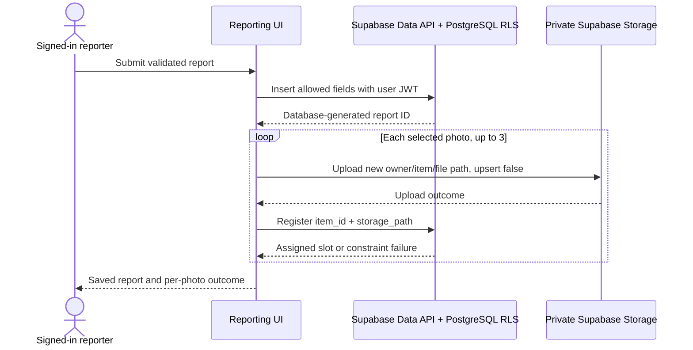

# Task 04A — Item Reporting implementation plan

Review date: 31 October 2026. Status: READY TO IMPLEMENT after the reviewed security baseline is integrated through the separately approved Git process. This document proposes implementation; it does not claim Reporting or Storage API acceptance has passed.

## 1. Scope and current baseline

Deliver one usable reporting flow: sign in, create a LOST/FOUND report, optionally attach photos, view personal reports, edit permitted fields, and add/remove personal report photos. Reuse Authentication, PostgreSQL RLS, Supabase clients and existing protected layouts. Stop additional Authentication edge-case work except critical defects.

Repository inspection and fresh `git fetch origin main` confirm:

| Worktree / branch | Current state | Handling |
| --- | --- | --- |
| Primary checkout / main | Local commit 1df5608; user next.config.ts modification | Preserve; do not switch/reset or synchronize develop |
| Current checkout / test/auth-hosted-e2e | a3f91c3; uncommitted Auth security fixes, CI, tests and review artifacts | Preserve in place; integrate reviewed essential fixes through separate approval |
| Authentication checkout / feat/authentication | c065176; local next-env.d.ts modification | Preserve |
| Security checkout / fix/nextjs-security | a3f91c3; only package.json and package-lock.json modified | Finish this patch independently before business-feature publishing |

`origin/main` remains `a3f91c31235b2102fea2e3dbebbc9af4f3f59de2` (PR #5). Auth commit c065176 is its ancestor. The security patch is not committed, published or merged. Current inspection confirms installed `next`, direct `@next/env`, and `eslint-config-next` are all **16.4.3** in the security checkout. Fresh `npm audit --omit=dev --json` exits 0 with **zero findings**. The patch still changes only the two dependency files (53 insertions / 53 deletions). Main still declares 16.4.0.

Previous combined build/test evidence remains in `docs/task03b-final-security-integration.md`; a new build was not needed for this planning-only change. Password rotation from the earlier local incident remains human-unconfirmed. Retain that incident follow-up without expanding Auth functionality or treating unexecuted email/expiry cases as passed.

## 2. Existing schema and effective Cloud constraints

Reviewed both SQL migrations, database-design/RLS documentation, and live read-only Cloud metadata for project `gxbpprhivyxmtcqibncf`. No application rows, credentials, account data or passwords were read. Relevant Cloud columns/defaults, grants, policies, indexes and trigger names match the design below. A synthetic UUID path matches both the live Storage upload regex and image metadata path CHECK. This is metadata/expression verification, not a real upload test.

### Report contract

| Field | Existing database contract | Task 04A behavior |
| --- | --- | --- |
| id | Database-generated UUID | Obtain from successful insert; never allow caller-supplied identity |
| reporter_id | Defaults to auth.uid(); own-row create policy | Omit from insert; use authenticated identity for owner queries |
| type | LOST or FOUND; immutable after creation | Required choice on create; read-only on edit |
| title | Trimmed length 1–200 | Required, labeled text input |
| description | Nullable, maximum 5,000 characters | Optional textarea; plain text, no rendered HTML |
| category | Trimmed length 1–80; free text in database | Shared suggested categories plus Other/custom input; retain existing values |
| location | Trimmed length 1–200 | Required campus location text; no maps/geocoding |
| event_date | Required date; no past-only constraint | Valid calendar date, preserve YYYY-MM-DD without UTC conversion |
| status | OPEN default; protected from client writes | Display badge; no status mutation in 04A |
| timestamps | Database-generated and maintained | Display dates; never send writable timestamps |

Suggested initial categories: Electronics, Documents, Keys, Bags, Clothing, Accessories, Other. These are UI suggestions, not a new enum/table. Locations remain text to avoid inventing a campus directory.

Ownership is enforced by both grants and RLS. Authenticated users may insert their own OPEN reports and update only title/category/description/location/event_date. They cannot reassign reporter, change type/status/identity, or hard-delete reports. Owners can read their own terminal reports; other users and guests see only OPEN/IN_PROGRESS reports. Existing owner/discovery/location/search indexes are available; 04A needs no new indexes.

The current public SELECT grant covers all item columns on visible rows, including reporter_id and timestamps. Choosing a UI field allowlist does not make other database columns secret. Report title/description/location must contain discovery-safe information, not private ownership proof or contact credentials. Private profiles/claims remain separate.

### Photo contract and privacy

| Property | Verified existing restriction |
| --- | --- |
| Bucket | item-images; private, not public |
| File limit | 5,242,880 bytes (5 MiB) per file |
| Content types | image/jpeg, image/png, image/webp |
| Object path | reporter UUID / item UUID / new file UUID + jpg/jpeg/png/webp extension |
| Registered images | At most three item_images rows per item; database trigger assigns slots under a parent-row lock |
| Metadata writes | Insert only item_id and storage_path; owner may delete; no UPDATE |
| Object writes | Owner of the actual report; path prefix and Storage owner_id checked |
| Overwriting | No object UPDATE policy: use upsert:false, unique paths, explicit remove/add |
| Guests | Cannot select image metadata or download private objects |
| Other signed-in users | May read registered photos of reports visible through item RLS |
| Owner | Can also preview/remove their unregistered uploads |

**Private bucket does not mean owner-only photos.** Registered photos on active reports are member-visible under existing policies. Task 04A keeps these access rules and describes attachments as report photos. Do not put confidential claim evidence, unredacted identity documents or secrets there. Show a clear attachment notice before upload. Future private claim evidence requires its own reviewed storage contract.

Do not make the bucket public, call getPublicUrl, introduce a service-role photo signer, or publish bearer URLs in HTML/logs. Use session-authorized download to a temporary browser Blob URL for the owner UI. Revoke Blob URLs on removal, unmount and session loss; keep private pages uncached. Avoid a shared image optimizer/cache for these authenticated downloads. This avoids adding a signed-link lifecycle to 04A. Later public discovery can show text and anonymous image placeholders, with member photos after login; anonymous image publication requires a separate access review.

The three-image rule limits registered metadata, not every staged object. Bucket MIME/size rules do not establish byte-level content safety, malware scanning or EXIF redaction. No such processing pipeline exists. Enforce UI size/type/decode checks, make no stronger security claim, and document residual storage abuse/orphan risks rather than weakening RLS to mask them.

## 3. Pages and components

| Route | Implementation |
| --- | --- |
| /items/new | Replace existing protected placeholder with LOST/FOUND form and optional 0–3 photos |
| /my-reports | Replace placeholder with owner-only cards, newest first, 20 per page, empty/loading/error states and create CTA |
| /my-reports/[id] | Owner management detail: report content/status, photo gallery, add/remove photos, edit link |
| /my-reports/[id]/edit | Prefilled form for the five writable fields; immutable type displayed |
| /dashboard | Add reporting links using existing layout; no Auth redesign |

Use /my-reports descendants for private management because the existing protection rules already cover that root. Public /items listing and /items/[id] discovery detail belong to 04B.

Proposed modules under `src/features/reports/`:

- `validation.ts`, `types.ts`, `categories.ts`: shared field rules, explicit insert/update allowlists and types.
- `queries.ts`: server-only owner queries using request-scoped Supabase client.
- `services.ts`: session-scoped SDK operations for report create/update and image metadata.
- `report-form.tsx`: shared create/edit form, field errors, pending state and explicit success/failure.
- `report-card.tsx`, `report-list.tsx`, `report-status.tsx`: owner presentation and simple pagination.
- `photo-uploader.tsx`, `photo-gallery.tsx`, `storage.ts`: selection, preview, sequential upload, register/remove/retry and Blob cleanup.

Reuse Button/Input, Tailwind and Zod already installed. Add only small textarea/select/field UI primitives if needed. No new form framework, ORM, UI redesign or dependency upgrade is planned. Use visible labels, keyboard support, error announcements, touch-friendly controls and a single-column mobile layout without horizontal overflow at 360px; use wider layouts on desktop.

## 4. Data access architecture and upload lifecycle

Choose the existing Supabase Data API + user-session Storage SDK for ordinary reporting writes. Server Components render owner lists/details; interactive forms call a small feature service through the existing browser client. PostgreSQL constraints, column privileges, JWT identity and RLS remain the enforcement boundary. This is sufficient for 04A; no new Next.js REST endpoints, Server Actions, Edge Functions or privileged credentials are needed.

Every private page calls the existing requireUser. Queries explicitly filter `reporter_id = verified current user.id`, even though item RLS also permits public active rows. Management detail/edit additionally filters item ID and returns not found for another reporter's item. Never use an unrestricted item lookup to populate an owner-management page. Fetch explicit fields rather than select-star; bound list queries and fetch photos only as needed.

Browser writes rely on the JWT attached by the existing session client, not a reporter_id from form input. Before an operation, check the current user for useful session-expired UX; a UI/session check is not a substitute for RLS. Updates filter both item ID and current reporter; require a returned row before reporting success. A denied update returning zero rows must never be presented as saved.

Do not use the default read-only server render cookie adapter for mutations. If a later requirement genuinely needs a Route Handler, reuse the response-aware adapter and retain private/no-store headers, auth checks and origin checks. That is not required for the initial 04A implementation.

Operational sequence:

1. Validate form fields and selected files. Use optional photos so text-only reporting remains available. Disable repeat submission while pending; do not automatically replay an uncertain report insertion.
2. Insert the report first; omit reporter_id, id, status and timestamps. The resulting ID is required by Storage ownership policies.
3. Upload sequentially to the private bucket using a fresh UUID filename, mapped extension, `upsert:false`, and conservative cache settings. Direct browser-to-Storage transfer preserves the existing 5 MiB allowance without routing image bodies through Next.js. Standard uploads suit this size range. No TUS dependency is needed.
4. After each successful upload, insert only item_id/storage_path into item_images. Let the database assign image_slot. Do not attempt to set it or bypass a concurrent fourth-image rejection.
5. On metadata failure, first distinguish definite rejection from an uncertain network outcome. For uncertainty, query the unique storage_path as the owner; if registered, keep it. If registration definitely did not succeed, remove only the newly uploaded object from this attempt. If reconciliation/cleanup fails, retain its path in the current operation state and offer a scoped retry. Do not delete a possibly registered object blindly.
6. Preserve the report and successfully registered images when another photo fails; show partial success and direct the user to manage remaining photos. Storage and PostgreSQL writes are not one atomic transaction. Report hard deletion is unavailable and is not compensation.
7. For user-requested photo removal, verify owner/item linkage, remove metadata first, then remove that exact object via Storage API. Owner access to staged objects permits cleanup after metadata deletion. Reconcile uncertain outcomes before retry; show a cleanup-pending state if object removal fails. Never delete Storage internals with SQL or scan/delete broad prefixes.
8. Replacement is explicit remove then add, with no overwrite and no claim of atomic replacement. Refresh owner views after successful mutations. Do not persist bearer tokens or sensitive photo URLs in diagnostic evidence.

A closed tab can interrupt compensation. A durable orphan sweeper/quota service is not part of this slice; document recovery limits and do not silently add a privileged background cleanup function. Existing Storage INSERT policy is not a per-account total-byte quota. Basic UI file limits do not prevent a malicious authenticated client from staging extra objects.

## 5. Minimal API/database changes

Initial implementation: **zero migrations, zero bucket/policy changes, zero new RPCs and zero Edge Functions**. Existing grants and APIs cover report creation, allowed edits, image registration and owner removal.

Do not add Delete report, Change type, Close, Mark returned, claim submission or claim approval controls to 04A. Report resolution and sensitive status workflows require the separately reviewed Task 05 authorization/transaction design. Avoid a generic service-role mutation endpoint.

If a hosted Reporting/Storage operation reveals a genuine privilege or schema defect, stop that specific operation, capture sanitized evidence and propose the smallest reviewed correction; do not invent a bypass or alter an old migration. New migrations/Cloud changes require the applicable explicit approval.

## 6. Acceptance criteria and evidence

All Reporting criteria below are **NOT RUN** at planning time. Earlier Auth/profile RLS acceptance is retained as baseline evidence; it does not prove item/photo workflows.

| Area | Required acceptance |
| --- | --- |
| Create | A signed-in normal user creates LOST and FOUND reports; values persist with their verified owner and OPEN default |
| Validation | Required/blank/overlength fields and invalid calendar dates fail clearly; optional description/photos work; text remains plain text |
| Owner management | My reports contains only the current user's reports, including terminal states; owner detail/edit works after reload; empty and paginated states work |
| Editing | Allowed fields persist; type/owner/status/identity/timestamp tampering fails; zero-row writes are handled as failure |
| Cross-user writes | Account B cannot edit A's report, forge ownership, register/delete A's image metadata or upload/delete inside A's object prefix; test both directions where applicable |
| Expected reads | B and guests may read A's active report text; private owner-management page denies B. Do not assert all cross-user item reads should fail |
| Photos | Real JPEG/PNG/WebP uploads/downloads work; 0–3 images, unique paths, reload, removal and add-after-removal work |
| Upload rejection | >5 MiB, disallowed MIME, invalid path, overwrite and concurrent fourth metadata registration fail without exposing another owner's data |
| Photo visibility | Guest downloads fail; B cannot read A's unregistered staged upload; B can read a registered active-report photo as policy permits; terminal-report restrictions checked on suitable fixtures |
| Failure recovery | Simulate upload failure, metadata rejection, uncertain response and cleanup failure; report survives, existing photos survive, no false all-success message |
| Security regression | Missing/invalid session cannot write; private pages retain no-store protection; no tokens/passwords/private photo URLs in logs or review artifacts |
| Responsive UI | Create/list/manage/edit usable at 360px and desktop; labels, keyboard, pending state and error announcements checked |
| Local validation | npm ci; lint; build; typecheck; auth tests; Supabase config tests; new essential reporting tests; production localhost smoke; production audit zero; git diff --check |

Run build before final typecheck where generated Next route types are required. Add focused tests for field allowlists, date/path validation, operation failure/reconciliation, owner query scoping and visible UI outcomes. Use existing SQL RLS tests as a regression suite when the local database is available; do not treat mocks as hosted authorization evidence.

Use the two existing verified development accounts for real item/photo acceptance; no new account or email flow is needed. Agree on a small synthetic report/photo fixture set before writing hosted data, because reports cannot be hard-deleted by ordinary clients. Do not delete existing accounts, reports or objects. Cleanup is limited to explicitly created test objects and approved fixture actions. Any terminal-status fixture requiring privileged mutation needs separate approval; mark that case NOT RUN if unavailable.

CI should retain existing Auth/config/build/typecheck/audit/localhost checks and add essential reporting unit tests. Do not require Cloud credentials, hosted accounts or network-dependent reporting acceptance in ordinary PR CI. Keep production audit failure fatal. Capture Cloud reporting results separately as PASS/FAIL/NOT RUN.

## 7. Git and implementation sequence

1. Complete `fix/nextjs-security` through the already prepared review and separate explicit approval: dependency-only commit, push, PR, CI and approved merge to main. Do not duplicate this patch in test/auth-hosted-e2e. Do not interpret this planning request as approval to publish.
2. Preserve all Auth worktree changes and review artifacts. Integrate the already reviewed critical form/security fixes and useful CI through their approved Git process. Do not resume email/natural-expiry investigation. Keep raw evidence, local config/type changes and unrelated work out of broad staging.
3. Fetch updated origin/main and verify approved security/fix ancestry and clean production audit. Create a **new isolated worktree** on **feat/item-reporting** from that baseline; leave every existing checkout untouched. Do not branch from an uncommitted dirty snapshot or copy the entire Auth tree.
4. Implement field contracts/services and text-only report creation first; then owner list/detail/edit. Demo persisted owner data before adding photo complexity.
5. Add the private upload/register/download/remove lifecycle and failure recovery. Exercise item/photo ownership with the existing A/B accounts; do not repeat unrelated Auth acceptance.
6. Finish mobile/accessibility states, essential regression tests, production smoke and audit. Present full diff, narrow staging list and acceptance evidence. Proposed feature commit/PR title: **feat(reports): add lost and found item reporting**. Commit/push/PR/merge only after explicit approval.
7. Start 04B after 04A review: reuse report contracts/categories and reviewed text/photo access rules for public discovery. Create the initial Vercel deployment only after Reporting + Search function and deployment is explicitly approved. Implement minimal claims/atomic Edge workflows in 05, then update the deployment under approval.

No worktree, source, migration, dependency, Cloud setting or deployment was changed by this plan. Only this planning document was added. Existing review reports remain historical snapshots and are not overwritten by the new MVP priority.

## References reviewed

- Local migrations: `supabase/migrations/20261012000100_application_schema.sql`, `supabase/migrations/20261012000200_private_image_storage.sql`.
- Existing contracts: `docs/database-design.md`, `docs/rls-security.md`; protected placeholders and current Supabase clients.
- Version-installed Next.js guides: `node_modules/next/dist/docs/01-app/01-getting-started/07-mutating-data.md` and `01-app/02-guides/server-actions.md`. Reporting uses session SDK writes to avoid adding an unnecessary server mutation layer.
- [Supabase standard uploads](https://supabase.com/docs/guides/storage/uploads/standard-uploads): standard SDK uploads fit files below 6 MB.
- [Private Storage buckets](https://supabase.com/docs/guides/storage/buckets/fundamentals): private downloads require authorized requests or time-limited signed URLs; public buckets bypass read controls.
- [Storage access control](https://supabase.com/docs/guides/storage/security/access-control) and Supabase documentation search, reviewed during planning.
- Supabase changelog checked on review date. The announced legacy TLS cipher removal affects obsolete clients; it does not require changing this modern browser/Node SDK architecture or Cloud settings.
