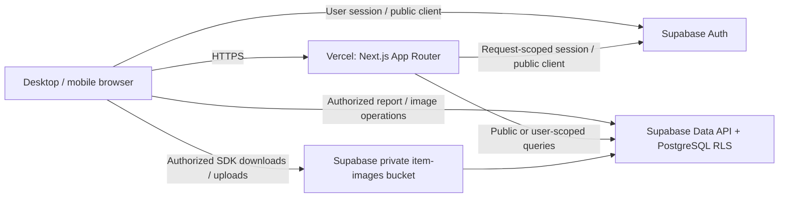

# CampusFind — initial Vercel deployment guide

This guide separates reviewed configuration from executed Cloud operations. Consult `task06a-deployment-report.md` for the actual state and approved actions. No URL below is an invented deployment address: the Vercel domains must be obtained from the authenticated project dashboard before use.

## Implemented architecture

Auth, Reporting and Search are implemented. Claims/Return workflows and Supabase Edge Functions remain Task 05; they are not deployed or represented as complete.

## Source and build settings

Use the verified GitHub `main` baseline containing PRs #6–#9. Target repository: `aanhtuan/campusfind-serverless`. Intended Vercel project name: `campusfind`, subject to checking existing projects and name availability in the selected account/team.

| Setting | Reviewed target |
| --- | --- |
| Framework | Next.js, automatic framework integration |
| Root directory | Repository root |
| Node.js | 22.x, consistent with .nvmrc and project minimum |
| Installation | npm ci |
| Build | npm run build, retaining next build --webpack |
| Output | Framework default; no static-export override |
| Production branch | main |
| Plan | Existing Hobby/free scope if available; no purchase or upgrade |

No vercel.json, application rewrite or new infrastructure layer is currently required. Do not replace webpack, bypass the production audit, disable confirmation, or alter policies to make a deployment succeed.

## Approval and first-deployment constraint

Before any project creation/linking, environment update or initial deployment, present the actual account/team, existing project state, verified Git SHA, build settings, environment names/scopes, observed domains, plan and exact mutations for explicit approval.

Vercel's current documentation states that the first deployment of a new project is always Production, including an explicit Preview target. Therefore a new project cannot satisfy a literal Preview-first/Production-only-after-review sequence without an approved exception. Do not click the import/deploy button assuming it creates only a Preview.

If no prior deployment exists, stop for a specific decision. One reviewable option is an explicitly approved staged initial Production build with automatic domain assignment disabled, followed by an actual Preview deployment and separate approval for promotion/public Production. This is still a Production-target build and must be labeled that way. Confirm staging controls and deployment protection in the actual account before proposing the exact action. Do not intentionally create a failed bootstrap deployment to evade the gate.

The authenticated Atunas/Hobby scope currently has no projects. Its Import screen exposes an empty-project creation path. The first proposed mutation is an approved empty campusfind project only, followed by reading its actual domain/settings; Git connection, environment/Auth changes and deployment are deferred to the next exact approval. If that flow would deploy automatically, stop before its final action.

For an existing project with deployment history, verify that the next deployment really targets Preview. Importing/linking Git may enable automatic deployment on later commits; disclose and review that behavior.

## Environment configuration

| Name | Purpose / source |
| --- | --- |
| NEXT_PUBLIC_SUPABASE_URL | Verified campusfind-dev API origin |
| NEXT_PUBLIC_SUPABASE_PUBLISHABLE_KEY | Enabled modern public publishable key from that same project |
| NEXT_PUBLIC_SITE_URL | Exact trusted HTTPS origin observed in Vercel |

These public variables are required at build time. Configure the correct target environment and rebuild when changing them. Never use localhost, a guessed domain, a path/query suffix or exported secret values for the deployed site origin.

Never add a service-role/secret key, database password, user password, personal token or Supabase CLI token to frontend variables. Do not copy existing local environment files into the deployment or publish environment exports in source/evidence. Public keys are not authorization bypasses; all ordinary requests remain governed by the anonymous/user role and RLS.

Keep Preview and Production values/scopes explicit. A Preview built with the canonical Production origin may be used for public read-only checks, but its independent authentication is NOT RUN: protected redirects and confirmation flows will target the canonical origin. Prefer deferring authenticated acceptance to that stable domain over granting a broad preview wildcard. Independent Preview Auth requires separately approved exact-origin configuration and compatible callback allowlisting.

## Supabase Auth URL review

Read the actual hosted settings before proposing a change; local `supabase/config.toml` is not evidence of current Cloud settings. Preserve required existing localhost entries. Use only approved site/callback origins and avoid a global redirect wildcard.

The existing signup/resend code sets emailRedirectTo to the trusted origin plus `/auth/callback`, with a sanitized `next` query. The default destination produces `/auth/callback?next=%2Fdashboard`. Other allowed application destinations are encoded by URLSearchParams. Review these generated values against the actual allowlist; account for the query when approving any different-origin entry.

`/auth/callback` exchanges a PKCE code, verifies identity and preserves response cookies. `/auth/confirm` accepts supported email/signup token hashes, verifies identity and strips credentials on failure. Review the actual confirmation template: a default ConfirmationURL template must preserve the SDK redirect, while a custom token-hash template must point to the implemented confirmation route with its supported type and sanitized return destination. Do not change templates or send test emails without approval.

Before a hosted Auth update, show the existing Site URL/allowlist/template state and the exact proposed differences, explain each flow, obtain approval, apply only those changes and read the resulting values back. Do not alter JWT expiry, email confirmation, provider settings or sessions as a deployment shortcut.

## Session and photo security review

Existing request clients use getUser verification, request-scoped cookie adapters and private/no-store headers. The response-aware proxy marks refreshed cookies Secure for HTTPS and uses SameSite=Lax. Supabase's browser client intentionally uses browser-readable cookies; do not claim HttpOnly cookies or redesign this client architecture.

The installed browser SDK defaults do not explicitly add a Secure cookie option, while the HTTPS proxy does. Inspect the actual cookie attributes on the selected HTTPS deployment without exposing values before Production acceptance. Record this as an open verification item; if a minimal adjustment is required, prepare and review that targeted change before publishing it rather than claiming a completed security check.

The form POST fallback and disabled pre-hydration controls are already on main. Do not log credentials, callback URLs or user cookie values. Screenshots must not include real identities, private report evidence or sensitive URL parameters.

The item-images bucket remains private with existing MIME/size and registered-object authorization rules. Anonymous visitors receive placeholders. Authorized signed-in readers use SDK downloads and temporary Blob URLs, with cleanup on session/lifecycle changes. Do not make the bucket public or replace these downloads with public/signed bearer URLs.

## Validation and acceptance sequence

Run installation, lint, build, typecheck, Auth/Reporting/Search/config tests, production dependency audit and whitespace checks on the selected source. A local build is compilation evidence, not a Vercel deployment or hosted acceptance result.

After approved deployment, record actual deployment ID, environment, UTC timestamp, Git SHA, generated URL, domain assignment, status and sanitized build/runtime diagnostics. Check deployment protection separately from application Auth; an edge authentication page is not a successful app route response.

First perform read-only checks of landing/list/login/register/verification routes; protected Dashboard/new-report/My Reports/My Claims redirects; invalid/missing detail HTTP 404; diagnostics HTTP 404; assets, no-store/referrer headers and browser runtime errors. Verify the HTTPS site uses the intended Supabase project. Never infer success from a Vercel build alone.

Authenticated and write acceptance requires separate fixture approval. Proposed minimum: existing verified account A, one synthetic LOST report, one FOUND report and one small synthetic image; reuse existing verified B for ownership checks if needed. Do not create accounts or send emails automatically. Keep fixture IDs/ownership evidence private and never capture JWTs or passwords.

Verify persistence, owner/default status, editing, denied cross-user modification, private image upload/metadata/read access and denied anonymous/deletion access. Search the created records using title/type/category/location, inspect details and URL/pagination behavior, and check logout/reload/Back. Two reports cannot prove positive multi-page pagination; either retain the local pagination result as narrower evidence or request separately approved additional fixtures. Browser viewport checks at 360/390/tablet/desktop are simulated-device evidence; real-device acceptance is separate.

Use PASS, FAIL or NOT RUN for each executed case. Do not delete user records or accounts. Fixture cleanup must be explicitly approved and supported by current policies; Reporting has no general client delete and existing object-orphan limitations remain.

## Rollback and troubleshooting

Preserve the previous deployment ID/configuration before any approved release. For an existing successful Production history, an explicitly approved Vercel rollback can reassign the previous deployment. On a first release there is no earlier production version to roll back to. Rolling back frontend code does not undo database records, policies or Storage objects. Rebuild with reviewed environment values if restoring different build-time configuration.

- Public text works but login redirects incorrectly: check actual built site origin and hosted Auth URL settings; do not trust browser Host as the redirect authority.
- Confirmation lands in the wrong environment: compare generated SDK callback, template and exact allowed destination; rebuild after correcting variables, and do not send repeated emails.
- Protected pages return 503: validate all public configuration names/types and the trusted HTTPS origin.
- Private photos are absent: distinguish signed-out placeholders, missing metadata and Storage permission errors; never weaken policies.
- Preview returns 401: inspect Vercel Deployment Protection before interpreting application status. Do not disable it or obtain a bypass credential without approval.
- Build failure: inspect the exact error, Node version and webpack command; make the smallest reviewed correction, without force upgrades or security-check bypasses.

## References

- [Vercel deployment environments and first deployment](https://vercel.com/docs/deployments/environments)
- [Vercel staged deployments](https://vercel.com/docs/deployments/promoting-a-deployment)
- [Vercel Hobby limits and billing](https://vercel.com/docs/plans/hobby)
- [Supabase redirect URLs](https://supabase.com/docs/guides/auth/redirect-urls)
- [Supabase SSR guidance](https://supabase.com/docs/guides/auth/server-side/advanced-guide)
